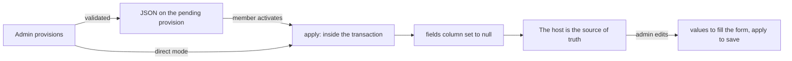
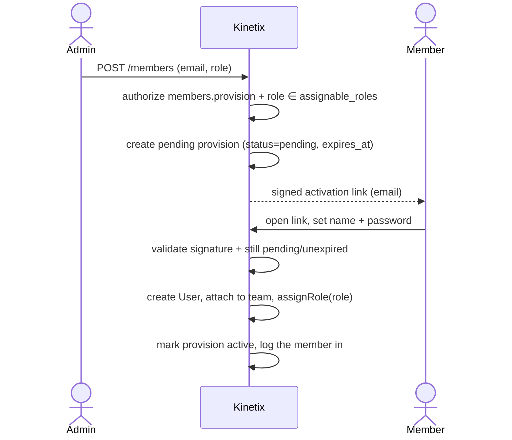
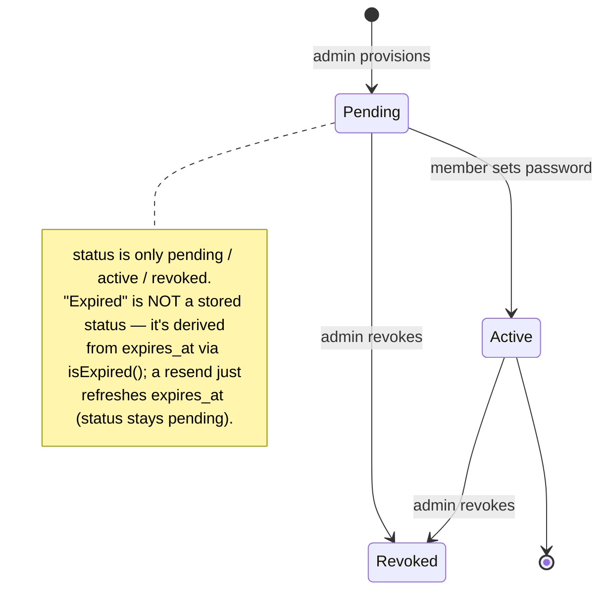
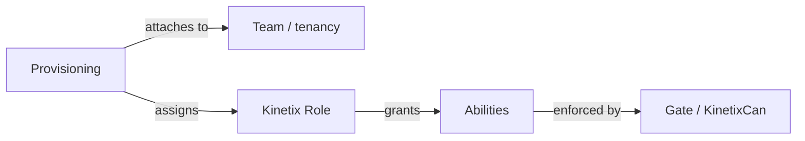

# Membership & Provisioning

Most starter kits assume a **consumer / self-serve** model: anyone registers,
gets their own *personal team*, becomes its *owner*, and grows it by emailing
peer **invitations** that the recipient self-accepts.

Many real projects need the opposite — an **admin-provisioned / directory**
model: an organization admin adds people, those people **do not** own anything
and **cannot** create their own team; they only **activate** their account by
setting a password. Registration is closed; the only way in is provisioning.

Kinetix Membership provides that second model as a drop-in alternative to the
starter kit's `InviteMemberModal` / `TeamInvitation` flow, and it composes
cleanly with the Kinetix [Roles & Permissions](/permissions) module.

::: danger Read this first — where the endpoints live
The module registers its **own** endpoints and `<KinetixMemberList>` calls them
itself. With teams on they live under:

```
{current_team}/{kinetix.route_prefix}/members/...   →  e.g. /acme/_kinetix/members
```

**Do not register your own `{current_team}/members` controller expecting the
component to hit it — it never will.** You register only the *Inertia page*
route. Run `php artisan kinetix:routes members` to see the resolved URIs,
methods and middleware.
:::

---

## 1. Two onboarding models

| Aspect | Starter-kit **Invitation** (self-serve) | Kinetix **Provisioning** (admin-controlled) |
|---|---|---|
| Who initiates | Anyone with `invitation:create` | An admin with `members.provision` |
| Account creation | Recipient **self-registers** | Admin pre-registers email + role |
| Activation | Recipient **accepts** an invite link | Member **sets a password** via signed link |
| Personal team | Auto-created on register (`is_personal=true`, `Owner`) | **None** — member joins the org team only |
| Role source | Fixed pivot enum (`Owner`/`Admin`/`Member`) | **Dynamic Kinetix role** (spatie), from a curated allow-list |
| Public registration | Open (`Features::registration()`) | **Closed** |
| Mental model | "Invite a collaborator" | "Add an employee to the directory" |

They are not competing implementations of the same idea — they are **different
onboarding philosophies**, which is why this is a *substitute* component, not a
new option on the same button.

---

## 2. Installation

Publish the provisions migration and run it:

```bash
php artisan vendor:publish --tag=kinetix-membership-migrations
php artisan migrate
```

Enable the module in `config/kinetix.php`:

```php
'membership' => [
    // Enable the provisioning module (opt-in)
    'enabled'           => env('KINETIX_MEMBERSHIP_ENABLED', false),

    // Scope provisioning to the active team: true/false wins, null (default)
    // inherits the global `kinetix.teams` switch. Keep it in agreement with
    // `permissions.teams` — provisions and the roles they assign should live
    // in the same tenancy model (kinetix:doctor warns when they disagree).
    'teams'             => env('KINETIX_MEMBERSHIP_TEAMS'),

    // The host's User model, created on activation
    'user_model'        => env('KINETIX_MEMBERSHIP_USER_MODEL', 'App\\Models\\User'),

    // Roles an admin is allowed to assign while provisioning. Anything outside
    // this list is rejected server-side — this is how you guarantee
    // "I add members but they never become admin". null (default) follows the
    // Roles screen (this team's roles + global ones); or a static array, a
    // [Class, 'method'] pair, or an invokable class-string — see "Where member
    // roles come from" below. The super-admin is never assignable here.
    'assignable_roles'  => null,

    // Hours an activation link stays valid
    'activation_expiry' => env('KINETIX_MEMBERSHIP_ACTIVATION_HOURS', 72),

    // Inertia page rendered for the set-password screen
    'activation_view'   => env('KINETIX_MEMBERSHIP_ACTIVATION_VIEW', 'Kinetix/MemberActivation'),

    // Where to send a member after a successful activation
    'redirect_after'    => env('KINETIX_MEMBERSHIP_REDIRECT', '/'),

    // Optional callables to (de)attach the activated user to the host's own team
    // pivot — Kinetix never touches it directly.
    // Signature: fn ($user, MemberProvision $provision) => void
    'attach_member'     => null,
    'detach_member'     => null,

    // Who gives a member their role: null = a Roles-screen (spatie) role in the
    // member's team; or [Class, 'method'] receiving
    // ($user, ?string $to, ?string $from, MemberProvision $provision) for roles
    // that live in your own logic. See "Roles from your own logic" below.
    'assign_role'       => null,
],
```

> Authorization for the management endpoints flows through Laravel's `Gate`
> exactly like `roles.manage`. With the [Roles & Permissions](/permissions)
> module enabled, just grant the `members.*` abilities to a role. Without it,
> define those gates yourself.

::: danger `attach_member` is required in a teams app
Kinetix assigns the Kinetix **role** and never touches your `teams` pivot — the
host owns that row. So with team scoping on and `attach_member` left at `null`,
activation succeeds, the member gets their role… **and belongs to no team**, which
in a team-routed app means they can't reach a single page. Kinetix logs a warning
at boot when it detects that combination:

```
Kinetix: membership team scoping is on but `kinetix.membership.attach_member`
is null — activated members will NOT be linked to any team.
```

Point it at a **callable array** — see [step 3](#_6-adapting-the-starter-kit) and
the callback forms below:

```php
'attach_member' => [\App\Kinetix\SyncProvisionedMember::class, 'attach'],
```
:::

### Mail prerequisites

The activation link travels by email (`MemberActivationNotification`, an
on-demand mail notification), so provisioning silently depends on two things
the module can't set up for you:

1. **A working mailer** — the usual `MAIL_*` env block. In local dev, point it
   at Mailpit/log to see the links.
2. **A running queue worker.** The notification `implements ShouldQueue`: with
   `QUEUE_CONNECTION=database` (the starter-kit default) and **no worker
   running, no email is ever sent** — while the admin sees a perfectly
   successful "Invitation sent" toast. If you don't run workers, set
   `QUEUE_CONNECTION=sync`.

The email subject/body use the `kinetix.member_activation_*` translation keys
(all locales), so brand or reword it by overriding those keys in your published
lang files. For a fully custom email, extend
`Happones\Kinetix\Membership\MemberActivationNotification` and rebind it in the
container.

## 2.1 Callback options (`config:cache`-safe)

Four options here take a callback: `attach_member`, `detach_member`,
`assignable_roles`, and (in Permissions) `owner_bypass.using`. `fields`
([§2.6](#custom-fields)) takes a class-string instead. **Never write them as a
closure.** A closure in a config file makes the config uncacheable, so the app
cannot be deployed with `config:cache`:

```
Your configuration files could not be serialized because the value at
"kinetix.membership.attach_member" is non-serializable.
```

Kinetix accepts two serializable forms instead, both resolved through the
container (an instance method gets a container-resolved instance, so you can
inject dependencies):

```php
// 1. A callable array — [class-string, method]. The recommended form.
'attach_member'     => [\App\Kinetix\SyncProvisionedMember::class, 'attach'],
'detach_member'     => [\App\Kinetix\SyncProvisionedMember::class, 'detach'],

// 2. An invokable class-string, when the class does one thing.
'assignable_roles'  => \App\Kinetix\AssignableRoles::class,   // __invoke($teamId): array
```

```php
namespace App\Kinetix;

use App\Models\Team;
use Happones\Kinetix\Membership\MemberProvision;
use Illuminate\Database\Eloquent\Model;

class SyncProvisionedMember
{
    public function attach(Model $user, MemberProvision $provision): void
    {
        if ($provision->team_id !== null) {
            Team::find($provision->team_id)?->users()->attach($user->getKey());
        }
    }

    public function detach(?Model $user, MemberProvision $provision): void
    {
        if ($user !== null && $provision->team_id !== null) {
            Team::find($provision->team_id)?->users()->detach($user->getKey());
        }
    }
}
```

A closure still works in development (and is fine in a service provider that
assigns config at runtime), but the callable array is the only form that survives
`config:cache` — so it is what the guides use.

### Where member roles come from {#dynamic-allow-list}

**By default the member picker is linked to the Roles screen.** With
`assignable_roles => null` and the permissions module on, it offers exactly
what the Roles screen shows — **the current team's roles PLUS global (team-NULL)
ones**, minus the protected roles — so a role created a second ago in Roles &
Permissions can be given to a member at once. Without the permissions module
the default is `['editor', 'viewer']`. Naming the resolver does the same thing
explicitly:

```php
'assignable_roles' => \Happones\Kinetix\Permissions\AssignableRoles::class,
```

::: tip Upgrading from v0.261 or earlier
Older published configs carry `'assignable_roles' => ['editor', 'viewer']`, a
fixed list that does **not** follow the Roles screen. Set it to `null` to link
the two. `php artisan kinetix:doctor` says which one you have, and warns when a
fixed list names roles that don't exist.
:::

::: warning Super-admin belongs to the team owner
Every `permissions.protected_roles` name (just `super-admin` by default) is
removed from the member picker **whatever `assignable_roles` returns** — a
fixed list or a callback that names it still can't hand it out, and the
provision, role-change and activation endpoints reject it with a 422. The
directory says so beside the role picker, so its absence isn't a mystery.
:::

::: warning Roles holding a platform ability are super-admin only
A role carrying a [platform-level ability](/permissions#platform-level-abilities-platform)
(`users.impersonate`, …) is assignable through membership **only by a
super-admin**. For anyone else — a team owner included, who passes
`members.update` through the owner bypass — it is left out of the picker and
the provision and role-change endpoints reject it with a 422, whatever
`assignable_roles` returns. Such a role crosses the tenant boundary, so a team
owner must not be able to hand it to an account. The check is one query
(`AssignableRoles::platformRoleNames($teamId)`). An invitation keeps the role
it was created with at activation: only the invite itself and later role
changes are checked against the acting user. Host code that calls
`AssignableRoles::names()` for its own assignment flow must drop
`AssignableRoles::platformRoleNames($teamId)` itself for non-super-admins.
`kinetix:doctor` warns about assigned roles that already carry one.
:::

The picker also tells the person choosing what a role grants: each role comes
with its permission count (and a *Global* mark for team-NULL roles), shown
under the select.

To withhold more names (e.g. keep `admin` promotion out of the invite flow),
wrap it in your own invokable:

```php
namespace App\Kinetix;

use Happones\Kinetix\Permissions\AssignableRoles as KinetixAssignableRoles;

class AssignableRoles
{
    public function __invoke(int|string|null $teamId): array
    {
        return KinetixAssignableRoles::names($teamId, except: ['admin']);
    }
}
```

::: warning Rolling your own query? Don't drop the global roles
A hand-written `where('team_id', $teamId)` silently excludes `team_id IS NULL`
— which is exactly where `KinetixRolesSeeder`'s `admin`/`editor`/`viewer`
presets live (seeded from the console = no team = global). The result is a
role that's fully manageable in the Roles UI and **invisible in the invite
picker**. The correct scope is the one `AssignableRoles::query()` gives you:

```php
->where(fn ($q) => $q->whereNull('team_id')->orWhere('team_id', $teamId))
```
:::

The callback is resolved on every request that lists or validates roles, so a
role created a second ago is immediately assignable — and it is still enforced
twice (provision + activation), the security boundary is unchanged. At
activation the callback receives the **provision's** team, since the signed
activation URL carries no `{current_team}` segment.

::: tip A list of role names is still just a list
An array is read as a callback **only** when it is a `[class-string, method]`
pair, so `['editor', 'viewer']` keeps meaning exactly what it looks like.
:::

### Roles from your own logic

Member roles don't have to be Roles-screen roles. If your app already decides
what a member is — a `role` column on the team pivot, a flag, another package —
give the picker your roles **and** take over assignment:

```php
'membership' => [
    'assignable_roles' => \App\Kinetix\MemberRoles::class,
    'assign_role'      => [\App\Kinetix\MemberRoles::class, 'sync'],
],
```

```php
namespace App\Kinetix;

use Happones\Kinetix\Membership\MemberProvision;
use Illuminate\Database\Eloquent\Model;

class MemberRoles
{
    /** The roles a member can be given in this team, with picker copy. */
    public function __invoke(int|string|null $teamId): array
    {
        return [
            ['name' => 'cashier', 'label' => __('Cashier'), 'description' => __('Rings up sales at the till.')],
            ['name' => 'supervisor', 'label' => __('Shift supervisor')],
        ];
    }

    /** null $to removes (revoke); null $from grants (activation). */
    public function sync(Model $user, ?string $to, ?string $from, MemberProvision $provision): void
    {
        $user->teams()->updateExistingPivot($provision->team_id, ['role' => $to]);
    }
}
```

- Entries may be plain names, role models, or `['name', 'label', 'description']`
  arrays; the label replaces the humanized name everywhere in the directory and
  the description shows under the picker.
- With `assign_role` set, Kinetix never calls spatie for members: activation,
  direct provisioning, role change and revoke all go through your callback.
- The allow-list is still enforced server-side, and the protected roles are
  still removed from it.

---

## 2.5 Provisioning modes (members with no email address)

Plenty of businesses employ people who simply do not have an email address —
so there is nowhere to send an activation link. Two config axes cover that, and
**both default to exactly the behavior above**.

```php
'membership' => [
    // 'activation' (default) | 'direct'
    'provisioning' => env('KINETIX_MEMBERSHIP_PROVISIONING', 'activation'),
    // 'mail' (default) | 'manual'
    'delivery'     => env('KINETIX_MEMBERSHIP_DELIVERY', 'mail'),
    // 'email' (default) | 'username' | 'phone'
    'identifier'   => env('KINETIX_MEMBERSHIP_IDENTIFIER', 'email'),
],
```

```bash
php artisan vendor:publish --tag=kinetix-membership-migrations
php artisan migrate
```

| | `activation` (default) | `direct` |
| --- | --- | --- |
| When the `User` exists | after they set their own password | immediately |
| What they receive | a signed activation link | a temporary password |
| Provision status after `store()` | `pending` | `active` |
| Needs a delivery channel | yes, unless `delivery: manual` | **no** |

`delivery: manual` sends nothing and hands the credential back to the admin
**once**, to pass on in person. It applies to both modes: an activation link in
`activation`, a temporary password in `direct`.

### Sending the link by SMS

```php
'delivery'                => 'sms',
'identifier'              => 'phone',
'sms_channel'             => 'vonage',                 // the channel YOU registered
'activation_notification' => \App\Notifications\SmsActivation::class,
```

**Kinetix deliberately does not pick an SMS provider.** Vonage, Twilio and the
local gateways each register their own notification channel and their own
message object, they are mutually incompatible, and which one is right is a
business decision about coverage and price in your country — in Mexico, for
instance, almost nobody uses Vonage.

So Kinetix routes over whatever channel you name and ships the message *text*;
your provider's message object is a few lines:

```php
use Happones\Kinetix\Membership\MemberActivationNotification;

class SmsActivation extends MemberActivationNotification
{
    public function toVonage(object $notifiable): VonageMessage
    {
        return (new VonageMessage)->content($this->smsContent());
    }
}
```

`smsContent()` is the translated one-liner (`kinetix.member_activation_sms`),
kept short on purpose: a signed URL is already long, and every character before
it pushes the message towards a second, billable segment. If your links are
close to the limit, put a short-link service in front of `$this->activationUrl`.

::: warning A link that can't be sent is never silently dropped
Laravel resolves `toVonage()` by name at *send* time, so a missing method throws
inside a queued job — where nobody sees it and the member never gets their link.
Kinetix checks the method exists **before** sending, and falls back to handing
the link to the admin. Same for a member with no phone number on file.
`kinetix:doctor` reports both, because the config would otherwise claim
something is being texted when nothing is.
:::

### The trade `direct` makes

The default exists so that **no password-less accounts pile up** — nobody has an
account until they prove they wanted one. `direct` gives that up: the account
exists from the moment an admin creates it, whether or not the person ever
signs in. That is the price of working with no delivery channel, and it is the
right price to pay when the alternative is not being able to onboard your staff
at all. Revoking still runs `detach_member` and removes the role.

### The credential is shown exactly once

```jsonc
// POST /_kinetix/members  →  201
{
  "id": 12, "identifier": "juan.perez", "status": "active", "role": "editor",
  "credential": { "type": "password", "value": "Xk7...", "expiresAt": "..." }
}
```

It is hashed on the way into the user record, so there is no reading it back —
only issuing a new one, which the dedicated endpoint does:

```
POST {prefix}/members/{provision}/credential
```

That endpoint always **regenerates**; the previous credential stops working. It
sits behind its own `members.credentials` ability, because handing someone a
credential means being able to become that person — a bigger privilege than
adding them to the directory. Every issue is written to the
[Activity log](activity.md) with who did it; the credential itself never is.

A new password for an existing member is a takeover, so it follows the same
guard as [impersonation](impersonation.md#_2-safety). The endpoint answers 403
("You can't issue credentials for this member.") when the member:

- is a super-admin and you are not;
- also belongs to a team you are not in (with teams on);
- holds, in any of their teams, a `membership.protected_permissions` entry
  (default `roles.manage`) that you don't hold there;
- owns one of their teams and you don't.

The guard reads a member's teams through `kinetix.team_switcher.teams_relation`
(default `teams`), which must return **every** team the user belongs to, owned
teams included. If your app keeps owned teams elsewhere (a Jetstream-style
`allTeams()` that merges `ownedTeams` and `teams`), expose them as one relation
and point `teams_relation` at it; otherwise teams the relation misses are never
checked. Without a relation, only `current_team_id` is.

Owning a team counts as holding `roles.manage` there only when the owner
bypass grants it, so an owner can issue a new password to their own admins
with the bypass on, but not when it is off or excludes `roles.manage`.

It is also blocked while impersonating. A new activation link for a pending
member (no account yet) is not affected.

::: warning `direct` needs the Credentials module
The forced first-login change that makes a temporary password safe lives in
[Credentials](credentials.md). With `credentials.enabled` off, the password an
admin chose keeps working forever — Kinetix logs a warning at boot and
`kinetix:doctor` reports it.
:::

### Identifiers other than email

`membership.identifier` must be one of `credentials.identity.fields`, or a
member could be provisioned under something nobody can then sign in with;
Kinetix falls back to `email` rather than let that happen. Values are
normalized through the same resolver the login uses, so a phone typed
`55 1234 5678` and `+52 55 1234 5678` cannot become two provisions. See
[Credentials §5](credentials.md#_5-signing-in-with-a-username-or-a-phone).

The API and the shipped components use `identifier` for display — whichever
field carries it — while `email`, `username` and `phone` travel alongside it.
`<KinetixMemberProvisioner>` takes an `identifier-type` prop mirroring the
server setting, so the field gets the right label and keyboard.

## 2.6 Custom member fields {#custom-fields}

Some members need more than a name and a role: a flag ("independent portal
access"), a job title, the branches they work in. Point
`membership.fields` at a class extending `MemberFields` and the members screen
collects those values when a member is invited and when they are edited. The
form is the Kinetix [forms engine](/forms), so rules, conditions, labels and
accessibility are the ones you already know.

```php
'fields' => \App\Kinetix\MemberBranches::class,   // a class-string: config:cache-safe
```

::: warning One migration, only for fields
Pending values live in a nullable JSON column, `kinetix_member_provisions.fields`.
Apps that adopt fields publish and run it; apps that don't never need it:

```bash
php artisan vendor:publish --tag=kinetix-membership-migrations && php artisan migrate
```

`kinetix:doctor` reports a configured `fields` class whose column is missing.
:::

### The contract

```php
use Happones\Kinetix\Membership\MemberFields;
use Happones\Kinetix\Membership\MemberFieldsContext;
use Happones\Kinetix\Membership\MemberProvision;
use Illuminate\Database\Eloquent\Model;

class MemberBranches extends MemberFields
{
    public function schema(MemberFieldsContext $context): array;   // Kinetix form components
    public function values(Model $user, MemberFieldsContext $context): array;   // read back, ACTIVE members
    public function apply(Model $user, MemberProvision $provision, array $values, MemberFieldsContext $context): void;
}
```

The class is resolved through the container, so constructor injection works.
`MemberFieldsContext` is immutable and read by name; new properties may arrive
in minor versions.

| Property | Meaning |
|---|---|
| `operation` | `MemberFieldsOperation::Provision`, `Edit` or `Activation` |
| `teamId` | The provision's team (the request's team while provisioning) |
| `actor` | The admin acting; `null` on activation, where the member acts for themself |
| `provision` | The `MemberProvision`; `null` while the provisioning form is built |
| `user` | The member's account, once it exists |

### Lifecycle



- **Pending**: the validated values are the JSON `fields` column. Editing a
  pending member rewrites the JSON; `apply()` is not called, there is no account yet.
- **Activation** (and `direct` provisioning): `apply()` runs inside the same
  database transaction that creates the user, runs `attach_member` and assigns
  the role. If any of them throws, nothing is kept: no user, the invitation
  stays pending. Afterwards the column is set to `null`: the host owns the
  data, and Kinetix keeps no stale copy. The values still travel on the
  `MemberActivated` event.
- **Active**: the edit form opens with what `values()` returns; saving calls
  `apply()` with the full state (not a diff) inside a transaction.

`apply()` runs with spatie's team pinned to the provision's team. `$values` may
lack keys for invitations sent before the field existed: read with a default.
If an id stored at invitation time has disappeared by activation, activation
still succeeds and `apply()` should drop it.

### Supported components

- Inputs: `TextInput`, `Textarea`, `NumberField`, `Checkbox`, `Toggle`.
- Options: `Select` (static, closure or enum options, `relationship()`), `Radio`,
  `CheckboxList`, `TagsInput`. The multi-choice field is `CheckboxList`.
- Dates: `DatePicker`, `DateTimePicker`, `TimePicker`.
- Layout: `Section`, `Grid`, `Fieldset`, `Placeholder`, `Hidden`.

Not supported: `FileUpload`, `MediaLibrary`, `Repeater`, `TableRepeater` and
`RichEditor` (they need a record or an upload descriptor), write-only secrets,
and server reactivity (`live()`). Client-side `visibleWhen()` and
`requiredWhen()` work.

### Options are an allow-list

Member forms are built in strict-options mode: every `Select`, `Radio` and
`CheckboxList` whose options come from your `schema()` rejects a value that is
not one of them, with the error on `fields.<name>`. Resolve option lists for
`$context->teamId`, and a forged id from another team never validates. A
remote `searchUsing()` select cannot be enumerated and is **not** constrained:
add a team-scoped `Rule::exists()` to it.

A `Select` built with `relationship()` works too, if the relationship is defined
on `membership.user_model` (that model is the form's owner). It is checked with a
query on the related table (so the eager options cap never rejects a valid id),
the ids must match exactly (`1abc` is not `1`), and your relationship query
modifier still applies.

Only the schema's own fields reach the JSON or `apply()`, so a smuggled key is
dropped. A `disabled()` field keeps its current value: a submitted value for it
is ignored, not stripped. A field is **shown** to the acting admin unless it,
or a layout around it (`Section`, `Grid`, `Fieldset`, tabs), is hidden by
`hidden`/`visible(false)`/`hiddenOn`/`visibleOn`. A field that is not shown has
no validation rules (a required field inside a hidden section never blocks the
save), ignores a submitted value, and is left out of the form `data` and
`rules` sent to the browser. On **edit** it keeps its previous value, as does
a stored key the schema does not know, so `apply()` still receives the full
state and one admin saving a form never wipes what another could see. A field
that a client-side condition (`visibleWhen`) hides is still shown by this
definition: it travels to the browser and is cleared when the condition hides it.

To tell whether an edit changed anything (and so whether `MemberUpdated` fires),
values are normalized: keys are sorted and lists of scalars are sorted too, so
reordering alone (a `TagsInput`, a `CheckboxList`) is not a change. Return
option ids from `values()` as strings, like the form state.

Restrict who may touch a field through `schema($context)`: the actor is
in the context, so a field can be hidden or `disabled()` for them.

### Recipe A: an "Independent portal access" checkbox

```php
// users.portal_access (boolean, default false)
class MemberPortalAccess extends MemberFields
{
    public function schema(MemberFieldsContext $context): array
    {
        return [Toggle::make('portal_access')->label('Independent portal access')];
    }

    public function values(Model $user, MemberFieldsContext $context): array
    {
        return ['portal_access' => (bool) $user->portal_access];
    }

    public function apply(Model $user, MemberProvision $provision, array $values, MemberFieldsContext $context): void
    {
        $user->forceFill(['portal_access' => (bool) ($values['portal_access'] ?? false)])->save();
    }
}
```

Gate the portal routes with a middleware or a `Gate` that reads the column:
the checkbox grants nothing by itself.

### Recipe B: branches, end to end

1. **Schema.** A `branches` table with an indexed `team_id`, and a `branch_user`
   pivot (`branch_id`, `user_id`).
2. **Relation.** `User::branches()`, a `belongsToMany`.
3. **Fields class.**

```php
class MemberBranches extends MemberFields
{
    public function schema(MemberFieldsContext $context): array
    {
        return [
            CheckboxList::make('branch_ids')
                ->label('Branches')
                ->options(fn () => Branch::where('team_id', $context->teamId)->pluck('name', 'id')->all())
                ->bulkToggleable(),
        ];
    }

    public function values(Model $user, MemberFieldsContext $context): array
    {
        return [
            'branch_ids' => $user->branches()
                ->where('branches.team_id', $context->teamId)
                ->pluck('branches.id')->map(fn ($id) => (string) $id)->all(),
        ];
    }

    public function apply(Model $user, MemberProvision $provision, array $values, MemberFieldsContext $context): void
    {
        // Re-scope on write: activation happens later, and options may have changed.
        $chosen = Branch::where('team_id', $provision->team_id)
            ->whereKey($values['branch_ids'] ?? [])
            ->pluck('id');

        // Only this team's branches are detached; other teams' rows are never touched.
        $user->branches()
            ->where('branches.team_id', $provision->team_id)
            ->whereNotIn('branches.id', $chosen)
            ->detach();

        $user->branches()->syncWithoutDetaching($chosen);
    }
}
```

4. **Scope the records.** Restrict what a restricted role sees in
   `Resource::getEloquentQuery()`, for example `branch_id IN` the user's branches:

```php
public static function getEloquentQuery(): Builder
{
    $query = parent::getEloquentQuery();
    $user  = auth()->user();

    return $user->hasRole('editor')
        ? $query->whereIn('branch_id', $user->branches()->pluck('branches.id'))
        : $query;
}
```

   These Kinetix surfaces honor `getEloquentQuery()`: the table (index, search,
   filters, sort, pagination), its aggregates, the record modal (read and
   create), inline cell edits and reorder, row actions, bulk actions, form
   reactivity (recompute) for a record, and the attach and associate pickers of
   a relation manager that declares `$relatedResource`.

   These do **not**, and need their own scope: an `Exporter` (override
   `query()`), an `Importer` (override `query()`), Spotlight (give
   `SpotlightResource` a query resolver), a `Select` filled by `relationship()` or
   `searchUsing()` (use `searchScope()` or a relationship query modifier),
   `Kanban`, `Calendar` and widgets (they take the query you hand them), and any
   custom page or route you write.

5. **Policy.** Re-check `branch_id` in `view`, `update` and `delete` too: your
   own routes and `KinetixQuery` callers can reach a record by id. A route
   prefix or a hidden button is not isolation.
6. **Clean-up.** Listen to `MemberRevoked` (or use `detach_member`) to remove
   the pivot rows when a member leaves.

---

## 3. Lifecycle: provision → activate

The module uses **pre-registration + activation**: the admin stores the email
and role as a *pending provision*; no `User` is created until the person
activates. This avoids orphaned, password-less accounts.



State of a single provision:



---

## 4. Data model

A lightweight pending-provision table (`kinetix_member_provisions`); the `User`
is only created on activation. It carries no foreign-key constraints because the
host's `teams`/`users` schema is unknown to the package.

| Column | Notes |
|---|---|
| `team_id` | Nullable — the module works without teams |
| `email` | Unique per team (`unique(team_id, email)`) |
| `name` | Collected at activation |
| `role` | A Kinetix role name |
| `invited_by` | The provisioning admin |
| `user_id` | Set on activation |
| `status` | `pending` · `active` · `revoked` |
| `fields` | Nullable JSON: custom member field values while pending, cleared on activation ([§2.6](#custom-fields)). Added by migration `000053`, only needed when adopting fields |
| `expires_at` / `activated_at` | Activation window + completion |

::: tip Adopting member fields on an existing install
Publish and run the new migration: `php artisan vendor:publish --tag=kinetix-membership-migrations && php artisan migrate`. `kinetix:upgrade` and `kinetix:doctor` point to it.
:::

> The activation **token** is not stored. The link is a Laravel
> `temporarySignedRoute`, so validity is the signature plus the provision's
> `pending`, unexpired status — single-use without a bespoke token column.

---

## 5. Backend surface

The module registers a `members` feature with the permission registry, so its
abilities show up in the [permission matrix](/permissions#_6-role-management-ui)
and `kinetix:permissions:sync`:

* `members.viewAny` — View members
* `members.provision` — Add / invite members
* `members.update` — Change a member's role and details
* `members.revoke` — Remove members

Endpoints (mounted under the Kinetix route prefix — the same pattern as the
permission routes). `{prefix}` is `{current_team}/_kinetix` with teams on,
`_kinetix` without; `php artisan kinetix:routes members` prints the resolved URIs:

| Method | Endpoint | Ability | Description |
|---|---|---|---|
| `GET` | `{prefix}/members` | `members.viewAny` | List provisions + the assignable-role allow-list |
| `POST` | `{prefix}/members` | `members.provision` | Provision an email + role |
| `POST` | `{prefix}/members/{provision}/resend` | `members.provision` | Re-send the activation link |
| `GET` | `{prefix}/members/{provision}/fields` | `members.update` | The edit form of the custom member fields, filled with the member's current values (404 when not configured) |
| `PUT` | `{prefix}/members/{provision}` | `members.update` | Change a member's role and, with `fields`, their custom fields |
| `DELETE` | `{prefix}/members/{provision}` | `members.revoke` | Revoke a member |
| `GET` | `/members/activate/{provision}` | — (signed) | Public set-password page |
| `POST` | `/members/activate/{provision}` | — (signed) | Complete activation |

The **allow-list check is the security boundary** for your requirement: even a
user who can `members.provision` cannot escalate someone to `admin` if `admin`
is not in `membership.assignable_roles`. It is re-checked at activation time too,
in case config changed between provisioning and the click.

### Revoking from code

Outside the members screen (an admin panel, a console command, a job), revoke
with `KinetixMembership::revoke()`. It does what the `DELETE` endpoint does:
the member's role in the provision's team goes, your `detach_member` callback
runs, and the provision is kept as `revoked` for the audit trail. It checks no
ability, so gate it yourself. Revoking a revoked member changes nothing.

A pending row has no user yet, so revoking it only marks it revoked; it never
looks a user up by email. Re-provisioning an active member before 0.275 reset
their row to pending and dropped its user, so revoking such a row leaves their
role in place. `kinetix:doctor` warns about pending provisions whose identifier
belongs to someone who is already a member of that team (any existing user,
without teams): review each one, then remove the member from their own row or
cancel the invitation.

```php
use Happones\Kinetix\Membership\KinetixMembership;

KinetixMembership::revoke($provision, $actor);   // $actor is optional (null from code)
```

The revoke is one transaction that re-reads the row under a lock, so a
concurrent double revoke (or activation) does nothing the second time; a
throwing `detach_member` leaves the member as they were. The same holds for activation, direct provisioning and edits.

### Lifecycle events

Four events, in `Happones\Kinetix\Membership\Events`, fire whether or not
custom fields are configured. All implement `ShouldDispatchAfterCommit`, so a
listener never sees something that rolled back, and use `SerializesModels`, so
queued listeners work.

| Event | When | Properties |
|---|---|---|
| `MemberProvisioned` | An admin provisions a member (also a repeat invitation) | `provision`, `actor`, `fields` |
| `MemberActivated` | The member has an account: they activated, or direct provisioning created it | `provision`, `user`, `fields`, `direct` |
| `MemberUpdated` | A role or fields edit changed something (not on a no-op) | `provision`, `actor`, `previousRole`, `role`, `previousFields`, `fields` (null when untouched), plus `roleChanged()` and `fieldsChanged()` |
| `MemberRevoked` | A member was revoked, once (not on the repeat) | `provision`, `actor` (null from code) |

```php
use Happones\Kinetix\Membership\Events\MemberRevoked;
use Illuminate\Contracts\Queue\ShouldQueue;

class RemoveBranches implements ShouldQueue
{
    public function handle(MemberRevoked $event): void
    {
        DB::table('branch_user')->where('user_id', $event->provision->user_id)->delete();
    }
}
```

---

## 6. Adapting the starter kit

To switch a starter-kit app from the invitation model to this one, four changes
are needed:

1. **Skip personal-team creation.** In `app/Actions/Fortify/CreateNewUser.php`
   the starter kit calls `CreateTeam::handle(..., isPersonal: true)`. Gate that
   behind a config flag (or remove it) so provisioned members don't get a
   personal team.
2. **Close public registration.** Drop `Features::registration()` from
   `config/fortify.php`; the only entry point becomes the activation link.
3. **Attach members to your team** — *mandatory with teams on*, or activated
   members belong to nothing. Point `membership.attach_member` at a callback that
   writes your team pivot; Kinetix assigns the Kinetix role, the host owns the
   membership row. Use the callable-array form so `config:cache` keeps working
   (see [§2.1](#_2-1-callback-options-config-cache-safe) for the class):
   ```php
   'attach_member' => [\App\Kinetix\SyncProvisionedMember::class, 'attach'],
   ```
4. **Swap the UI.** Replace `InviteMemberModal` with `<KinetixMemberList>`.

---

## 7. Frontend (Vue / Inertia)

All components publish like the rest of Kinetix and read the same reactive
`kinetix_permissions` prop, so you gate them with the same `{feature}.{ability}`
keys. The role dropdown only ever offers roles in the server-enforced allow-list
(with the [`AssignableRoles` resolver](#dynamic-allow-list): the team's roles
plus global ones, minus protected roles).

### 7.1 Members directory

`<KinetixMemberList>` is the drop-in screen. It embeds the provisioning form —
the identifier field `membership.identifier` names (email, username or phone),
an optional name, and the role picker with what the chosen role grants — and
lists members with:

- **Where each one stands**: *Joined* date for active members; *Invited* date
  and link expiry for pending ones, or *Activation link expired — resend it*.
- **Status filters with counts** (All / Active / Pending / Revoked) and a search
  over name, identifier and role, once the list is longer than five.
- **Role change** in place. A member whose role is no longer assignable (an
  `admin` from before, a role you withheld) keeps it listed — locked, marked
  *not assignable* — instead of a blank select.
- **Resend**, **New link** (pending) / **New password** (active), and **Remove**
  behind a confirm dialog. Each action shows only when the viewer holds its
  ability (`members.provision`, `.update`, `.credentials`, `.revoke`) — the
  endpoint tells the UI, so a missing ability hides a button instead of
  answering a click with 403.
- **The credential, once**: when provisioning hands back a temporary password or
  a link (`direct` provisioning, `manual` delivery, a new credential), a dialog
  shows it ready to copy, with its expiry — it is never readable again.

Revoked rows show the role as read-only history — re-provision to bring someone
back (the server rejects role changes and resends on revoked provisions with a
422). Rows lay out by the card's width (a container query), so the directory
reads in a narrow column too.

Register only the Inertia **page** route (the data flows through the built-in
endpoints, exactly like the roles pages):

```php
// routes/web.php — plain:
Route::middleware(['auth'])->get('members', fn () => inertia('Members/Index'))
    ->name('members.index');

// or team-routed:
Route::middleware(['auth'])->get('{current_team}/members', fn () => inertia('Members/Index'))
    ->name('members.index');
```

```vue
<!-- resources/js/pages/Members/Index.vue -->
<script setup lang="ts">
import { useKinetixCan } from "@/composables/useKinetixCan";
import KinetixMemberList from "@/components/kinetix/KinetixMemberList.vue";

const { can } = useKinetixCan();
</script>

<template>
  <KinetixMemberList v-if="can('members.provision')" />
</template>
```

<Screenshot name="member-list" alt="Member list with provisioning form" />

Need a custom layout? Compose the presentational
`<KinetixMemberProvisioner :assignable-roles :roles :reserved-roles :identifier-type @submit>`
form (`submit(identifier, role, name?, fields?)`) with the `useKinetixMembers()`
composable: `load`, `provision(identifier, role, name?, fields?)` (returns the
provision, with its `credential` when there is one), `issueCredential`, `resend`,
`updateRole`, `updateMember(member, { role, fields? })`, `memberFields(member)`,
`revoke`, plus the reactive `provisions`, `assignableRoles`, `roles` (each with
`label`, `description`, `permissions`, `global`), `reservedRoles`,
`identifierField`, `can`, `hasFields` and `fieldsForm`; `memberFieldErrors(error)`
maps a 422 to `{ <field>: message }`.

With [custom member fields](#custom-fields) configured, the provisioner renders
them under the identifier row (props `fields`, `errors` and `resetOnSubmit`; it
keeps what was typed when the server answers 422), and each non-revoked row
shows an **Edit** button instead of the inline role select: a modal with the
role and the fields, loaded from `GET {prefix}/members/{provision}/fields`.
Without fields the directory is unchanged.

### 7.2 Activation page

`<KinetixMemberActivation>` is the public set-password screen. Create the page
file at **`resources/js/pages/Kinetix/MemberActivation.vue`** (that's what the
default `membership.activation_view` resolves to — or change the config to any
page you already have), forwarding the props the controller passes —
`identifier` (the email, username or phone the member is known by), `email`,
`team` (the name of the business they are joining, `null` without teams) and
the signed `action` URL:

```vue
<script setup lang="ts">
import KinetixMemberActivation from "@/components/kinetix/KinetixMemberActivation.vue";

defineProps<{
  identifier?: string | null;
  email?: string | null;
  team?: string | null;
  action: string;
}>();
</script>

<template>
  <KinetixMemberActivation
    :identifier="identifier"
    :email="email"
    :team="team"
    :action="action"
  />
</template>
```

The page says who is inviting them ("You were invited to join Acme Coffee") —
a set-password form that names no business reads like any phishing page.

<Screenshot name="member-activation" alt="Member activation — set password" />

Email is fixed (it came from the provision); the member only sets a name and
password, and the form posts back to the signed `action` URL.

---

## 8. How it composes with Roles & Permissions

The two modules are **independent but complementary**:

- **Teams answer _where_** — the tenancy boundary a member belongs to.
- **Roles/Permissions answer _what_** — the abilities a member has.
- **Provisioning sits at the intersection** — a single action that *adds a user
  to a team* **and** *assigns a Kinetix role*, with the assignable set policed
  by config.



You can adopt either module alone:

- **Permissions without provisioning** — keep the starter kit's invitations, but
  resolve abilities through Kinetix roles instead of the pivot enum.
- **Provisioning without permissions** — provision members and gate the
  endpoints with your own `members.*` gates; you lose the dynamic role matrix but
  the onboarding flow stands on its own. Bring your own roles with
  [`assignable_roles` + `assign_role`](#roles-from-your-own-logic).

### Assigning a role to a user who already exists

Kinetix ships no UI for "give this existing user a role" outside the members
list — if you keep the starter kit's invitation flow, assign the role yourself
where the user joins the team. **With teams active, pin spatie's team id
first**: `assignRole()` stamps whatever the registrar currently holds, and in a
listener/job that's undefined:

```php
use Spatie\Permission\PermissionRegistrar;

$registrar = app(PermissionRegistrar::class);
$previous  = $registrar->getPermissionsTeamId();
$registrar->setPermissionsTeamId($team->getKey());

try {
    $user->assignRole('editor');   // resolves team + global roles by name
} finally {
    $registrar->setPermissionsTeamId($previous);
}
```

(That try/finally is exactly what the built-in provisioning endpoints do
internally on activation, role change and revoke.)

Used together, you get the full B2B story: a closed directory where admins add
people and hand them exactly the capabilities you allow — never owner, never
admin, never a stray personal team.

---

## 9. Security considerations

- **Signed, expiring, single-use** activation links (Laravel signed URLs); never
  a plain incrementing id — validity is the signature plus the `pending` status.
- **Re-provisioning** — a repeat on a pending or revoked invitation refreshes
  it (`updateOrCreate`). Someone who is already an active member of the team
  is refused with 422 ("This person is already a member of this team."):
  change their role, issue a credential or remove them from their row instead.
  Re-provisioning used to reset the row to pending and drop its user, so a
  later revoke left their role in place.
- **Rate limits** — Kinetix throttles inviting (`kinetix.members.store`,
  `membership.invite_throttle`) and re-sending (`kinetix.members.resend`,
  `membership.resend_throttle`) per user; see [Rate limit](#rate-limit). The
  public, signed activation routes (`kinetix.membership.activate.show` /
  `kinetix.membership.activate`) are left to your app: e.g. a
  `RateLimiter::for()` keyed by IP applied via `->middleware('throttle:...')`
  in a route group that wraps them.
- **State machine is enforced** — a revoked provision rejects role changes and
  resends (422; re-provision deliberately instead), and resend on an active
  member is a 422 too (an activation link for an existing user would try to
  create a duplicate).
- **The allow-list is enforced twice** — at provision time and again at
  activation, so a later config change can't be exploited by an old link.
- **Platform roles are super-admin only** — a role carrying a platform-level
  ability (`users.impersonate`) can be assigned here only by a super-admin
  (422 for anyone else, owners included).
- **Member fields are validated server-side** — option fields are an
  allow-list (a forged id fails on `fields.<name>`), only schema fields are
  kept, and `members.update` guards them, the same trust level as a role change.
  Re-scope ids by `$provision->team_id` inside `apply()`: it can run long after
  the form was validated. Do not put secrets in member fields: there is no
  write-only support, and edit forms return the stored values.
- **Events carry personal data** — `MemberProvisioned` and `MemberActivated`
  hold the field values, so a queued listener serializes them into the queue
  payload (and `failed_jobs`). Keep personal data out of queued listeners, or
  queue only the provision's id.
- **Writes are transactional** — activation, direct provisioning, edits and
  revokes either complete or leave nothing behind (no orphan user, no phantom event).
- **Saving a member's details does not re-check an unchanged role** — only a
  changed role must be assignable, so a member whose role has left the
  allow-list can still have their fields saved. Sending the current role is a no-op.
- **Audit** who provisioned/revoked whom (`invited_by`, timestamps) — this is a
  privileged, organization-shaping action.

## Rate limit

`membership.invite_throttle` limits inviting (provisioning) members, which
sends the activation link (default `'10,1'`), and `membership.resend_throttle`
re-sending one (default `'6,1'`), per user, as `"attempts,minutes"`; `false`
turns either off. The members list shows the server's message. Over the limit the endpoint answers
`429` with `{"message": "<translated>", "code": "throttled", "retry_after": N}`
and the `Retry-After` header. The limit is read on every request, so it
also applies to cached routes.

## Activation passwords

The password a member chooses on the activation page follows the app's
`Password::defaults()` (8 characters minimum when the app sets none). Set
your rule in a service provider:

```php
Password::defaults(fn () => Password::min(12)->mixedCase()->uncompromised());
```
